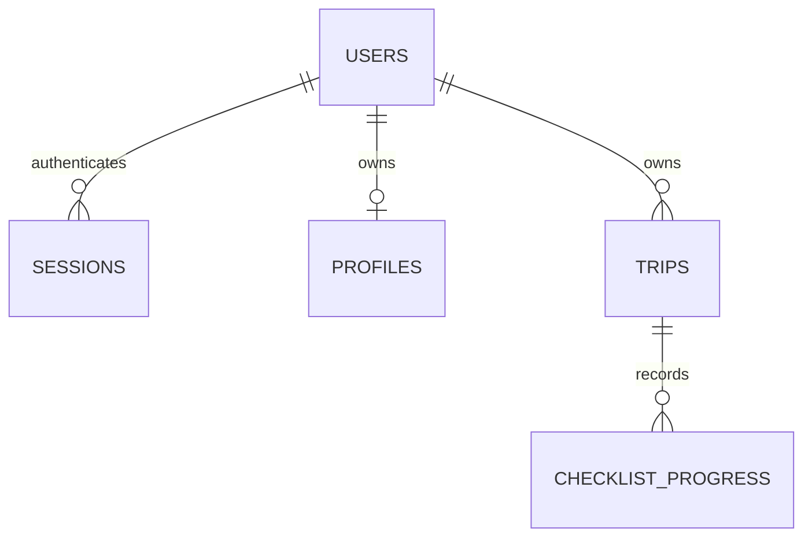

# Restrictapp 2 application reference

Last reviewed: 15 October 2026. README.md provides the quick start; this document
describes the active implementation. Restrictapp 3 is a separate repository with
different models and routes. Do not apply its Django instructions to this app.

## Purpose and topology

Restrictapp organizes travel preparation around nationality, residence, itinerary,
dates and purpose. It shows a conservative independent reference, official links,
optional GOV.UK guidance and a personal checklist. It never grants entry clearance.
Guest planning requires no account; accounts add profile/trip/progress persistence.
App-owned UI is English/German; published source content stays in its own language.

The active entry point is `api.main:app`. FastAPI serves the HTML/CSS/JavaScript
frontend and API from one origin. Local preview runs Uvicorn on loopback :8000
with SQLite; Render runs the same app behind its managed HTTPS ingress with Neon
PostgreSQL through DATABASE_URL. There is no project-owned Nginx container in v2.
The separate v3 stack already uses Nginx for React/static serving and API proxying;
switching this live app to that topology is a deployment migration, not a doc change.

Historical MongoDB crawlers, credential imports, routers and templates are retained
for reference but are not imported by the active app. Root requirements-lock.txt
is active; api/requirements.txt belongs to legacy code.

## Entities and relationships

The schema is initialized/compatibly extended by `api/storage.py`, not Django.
All active SQL binds input values. Integer IDs become PostgreSQL identity BIGINTs.

| Table/object | Data | Management and relationship |
| --- | --- | --- |
| users | id, unique normalized email, salted scrypt password string, preferred_language (en/de, default en) | Signup creates; login verifies and restores language; account deletion removes user. No public staff/admin entity. |
| sessions | SHA-256 token digest, user_id FK, expiry | Raw token only in HttpOnly cookie. Seven-day expiry; login removes expired sessions and bounds active sessions to 20/user. Logout removes current session; user deletion cascades all sessions. |
| profiles | user_id one-to-one FK, JSON text data | Nationality, residence, optional passport expiry. Explicit save/upsert; user deletion cascades. |
| trips | id, user_id FK, origin, destination, created text timestamp, JSON text context | Unique user/origin/destination. Saving same route updates context; changing context resets checklist progress. User deletion cascades. |
| checklist_progress | composite trip_id/task_id key, integer done flag | Per-trip checks; valid task IDs only. Trip deletion cascades. Definitions are generated in planning.py, not stored as task rows. |
| auth_attempts | keyed-hash bucket, attempts, expiry | IP/email counters persist across connections. Not linked by user FK; expired rows cleaned during auth/deletion attempts. Pseudonymous, not anonymous. |
| Trip/Traveler API models | Canonical countries, optional dates, expiry, purpose and transit | Derived validated input, not separate DB tables. Trip extends Traveler with route/date/purpose/transit fields. |
| Plan/reference/guidance | Scope, warnings, tasks, links, publisher dates and text | Derived on request; guest plans are not stored in account DB. Guidance has an in-process bounded cache. |

Country IDs come from countries.json. Origin/destination must differ. Nationality,
residence and optional transit must be catalog entries; transit differs from both
route ends. Return requires departure and cannot precede it. Purpose is tourism,
business, work or study. Saved profiles require nationality and residence.

## API reference

| Method | Path | Behavior |
| --- | --- | --- |
| GET | `/`, `/privacy`, `/cookies` | Planner or privacy/cookie document. |
| GET | `/manifest.webmanifest?lang=en/de`, `/sw.js` | Language-aware install metadata / public offline worker. |
| GET | `/api/health`, `/api/countries`, `/api/privacy` | DB health, canonical countries and public operator/contact details. |
| GET | `/api/search?origin=…&destination=…` | Validated route-feed state; no personalized passport decision. |
| POST | `/api/plan` | Traveler/route validation; returns context, notes, tasks, sources, authority links, reference and scope. |
| GET | `/api/guidance/{destination}` | GOV.UK sections or explicit unavailable/links fallback. |
| POST | `/api/auth/signup` | Uniform 202 for new/existing address; no auto-login. |
| POST | `/api/auth/login` | Generic credential errors; cookie on successful authentication. |
| GET / POST | `/api/me`, `/api/logout` | Current user / removes current session. Logout requires write protection. |
| GET / PUT | `/api/profile` | Owner's profile / explicit replacement. |
| GET / POST | `/api/trips` | Owner's trip list / save or update same route, with context-sensitive progress reset. |
| PUT | `/api/trips/{id}/checklist/{task_id}` | Owner-only progress update using `{done: boolean}`. |
| DELETE | `/api/trips/{id}` | Owner-only deletion. Another owner's ID returns 404. |
| GET | `/api/account/export` | Owner's JSON export; no password hashes/session tokens. |
| DELETE | `/api/account` | Email/password reauthentication; deletes account and related rows/sessions. |

Account mutation requests require `X-Restrictapp: 1`; supplied Origin must match
the application origin. Explicit cross-site Fetch Metadata is rejected. There is
no cross-origin allowlist. API responses are no-store. Standard errors include
401/403/404, 413 oversized body, 422 invalid input and 429 throttled/busy requests.
Validation errors do not return submitted credentials. Production interactive
OpenAPI endpoints are disabled. Password input is bounded to 10–128 characters.

## User journeys and navigation

1. **Explore.** Select departure/destination, passport country and residence.
   Optional expiry, departure/return, purpose and one transit stop refine tasks.
   Country suggestions accept English/German labels but submit canonical IDs.
   Swap changes route ends; destination cards select a destination. Editing any
   traveler/route field invalidates the prior result and progress in memory.
2. **Read the plan.** Review warnings, scope, reference category/withholding reason,
   publisher/import dates, limitations and source links. Load official guidance
   explicitly for entry, safety and health context. GOV.UK entry text generally
   addresses British citizen passport holders, not every nationality.
3. **Track/download.** Tick completed checks yourself. Guest checks stay in page
   memory. Download my preparation plan creates a local localized text file.
   Source text remains original; neither tasks nor download establish eligibility.
4. **Register/sign in.** Account controls open the authentication modal. Signup
   gives the same response for new/existing email, switches to sign-in and clears
   the password field. Successful sign-in loads the owner's trips/profile. When
   saving prompted sign-in, pending save resumes after authentication unless the
   dialog was cancelled. Emails are not verified and recovery is not implemented.
5. **Save profile.** Remember my traveler profile explicitly stores the Traveler
   subset. Later sign-ins can prefill those details. It does not update saved trips.
6. **Save/manage trips.** Save trip stores current context. Same user/route updates
   the saved row; identical context preserves checks, changed context clears them.
   My saved trips lists only the signed-in owner's rows and progress. View plan
   regenerates current sources and restores saved checks; Remove deletes a trip.
7. **Use account data controls.** My data opens export/deletion controls. Delete
   requires password and confirmation; related data and sessions cascade. Sign-out
   clears visible result/form/account state and removes current server session.
8. **Help/install/privacy.** How it works is reachable in desktop/mobile navigation
   and opens the collapsed guide accordion. Install app uses an available native
   prompt on supported Android/desktop browsers; otherwise it displays iPhone/
   Android/desktop-specific instructions. Installed mode hides the install action.
   Footer links open privacy, the essential-cookie notice and My data.

Explore/My saved trips are JavaScript view state on `/`, not separate pages.
Refresh loses unsaved guest state. Auth, data management and installation use
native dialogs. `/privacy` and `/cookies` are separate documents with language
selection and a return-to-planning link. Installation does not make planning offline.

## Frontend lifecycle and localization

`index.html` supplies the shell/forms/dialogs. app.js manages account, route/plan,
guidance, saved-trip ID, checked-task set, view, authentication mode and pending-save
state. Initialization loads countries/current user/trips/profile. Plan request
versions prevent stale results replacing newer input. Errors appear near the form
or in transient status messages. Writes disable relevant controls while pending.
Text is rendered with textContent; safeSource rejects unsafe citation URLs.

`i18n.js` uses explicit valid ?lang, saved device choice, browser language, then
English. It updates html language, labels, country suggestions, dates, links,
manifest, current results and dialogs without resetting entered credentials or
checklist progress. English API/storage values remain canonical. German catalogues
are de.json/privacy-de.json; rebuild locale-data.js with `python -m scripts.build_locales`.
privacy.js loads public operator/contact data. install.js handles prompt availability,
device instructions, double-tap protection and installed-state visibility.

style.css, responsive.css and the separate language.css control layout. The language
selector retains native keyboard/touch interaction with theme-specific styling.
The service worker caches only the public reconnect page, mark and translation
scripts. Planner HTML, APIs, private data and guidance are not offline cached.

## Data sources and trust

entry_reference.py reads a compressed TravelRequirements.info snapshot with its
licence/attribution under reference_data/. Only recent, usable government/IGO,
unflagged tourism citations can yield a dataset-reported category. Stale, future,
flagged, expired or unsupported records withhold it and retain official links.
Publisher verification dates are not independent Restrictapp checks. Existing
visas/residence exceptions, document type and transit eligibility remain unresolved.

guidance.py uses validated country slugs and fixed GOV.UK URLs, strips source HTML
to text, validates document type/path and caches successful content for an hour,
failures for a minute. Two concurrent fetches maximum; cache reads do not wait on
network work. Busy/outage requests return links without invented guidance.
travel_data.py optionally reads a configured local JSON feed, requires HTTPS
citations/check dates/requirements, and marks older-than-24-hour data stale.
No configured feed means unverified, not unrestricted travel.

## Security, storage and operations

Read SECURITY_REVIEW.md and PRIVACY_OPERATIONS.md. Passwords are scrypt hashes;
session tokens are random with only digests in DB. Hashing is capped at four
concurrent operations/process. Shared IP/email counters use the production rate
secret and 15-minute windows. Production uses Secure/HttpOnly/Lax session cookies,
TLS PostgreSQL, trusted hosts, HSTS, browser policies, bounded request bodies and
same-origin writes. The legacy style policy allows inline CSS; script CSP is self-only.

Cookie restrictapp_session lasts up to seven days. restrictapp_language in
localStorage and a one-year host-only SameSite=Lax cookie (Secure on HTTPS) remembers
en/de. Signed-in accounts additionally store their preferred language. The notice uses tab sessionStorage; the reconnect
assets use restrictapp-offline-v2 Cache Storage. These are essential/preference
storage, not advertising consent. Clear through browser site-data controls.
Hosting/backup logs may retain metadata beyond active-record deletion; operators
must maintain processor agreements, privacy responses, retention and deletion replay.

Use DEPLOYMENT.md for Render/Neon settings and migration instructions. Key settings:
DATABASE_URL, RESTRICTAPP_ENV, RESTRICTAPP_SECURE_COOKIES, RESTRICTAPP_RATE_SECRET,
RESTRICTAPP_ALLOWED_HOSTS/RENDER_EXTERNAL_HOSTNAME, optional RESTRICTAPP_DB and
RESTRICTAPP_TRAVEL_FEED, operator name and privacy email. Never put values in docs.
Health checks verify DB connectivity. Render ingress is the trust boundary for
its forwarded-header settings; do not reuse wildcard trust on a public standalone
Uvicorn server. Avoid SQLite on ephemeral production storage.

SQLite-to-empty-PostgreSQL migration is an explicit reviewed operation using the
existing script; legacy MongoDB/plaintext accounts need a separate reset/import
process. Back up, test restore and preserve ownership/progress before any cutover.
V3 has a different schema and no automated live importer. Do not reuse this DB
unmodified for Django. For failures, check service/DB health, host/proxy/cookie
settings and source availability before assuming the browser is the cause.

## Maintenance and AI support

Root and scoped AGENTS.md files define safe code ownership. README covers local
startup/tests; DEPLOYMENT.md, INSTALLATION.md, LOCALIZATION.md, SOURCE_EVALUATION.md,
PRIVACY_OPERATIONS.md and SECURITY_REVIEW.md cover their specialties. Keep them
consistent. Tests use disposable databases/fixtures; PostgreSQL-specific tests
require their explicit disposable test URL. Never use production accounts as fixtures.

Every commit after this reference's introduction must update both DOCUMENTATION.md and README.md.
Install the local guard with `git config core.hooksPath .githooks` after checking
existing hook configuration. Run `python scripts/check_docs.py --staged` before
committing. CI checks every new commit, including merges against their first parent;
history before adoption is exempt. Meaningless whitespace does not satisfy the
maintenance requirement. CI verifies changes, not prose accuracy; reviewers must
check the content. GitHub branch protection must require the check to enforce it
for merges. Hooks can be skipped by clients, so they are not the sole control.

## Current limits

No email verification/recovery/MFA, bookings/payments, guaranteed personalized
entry provider, multi-passport/multi-transit planning or private offline plans.
Security review and package scans do not prove absence of vulnerabilities. Official
rules must be rechecked before booking and departure. See the separate v3 reference
for React/Django/Nginx behavior; that is not this live application's runtime.

## Revision notes

- 15 October 2026 — Added the shared safe EN/DE error contract, database-outage
  responses, bounded browser requests and gateway/offline recovery. Added owner-only
  GET/PUT `/api/preferences`, additive user language storage, login restoration,
  export/migration support, privacy disclosure and ERROR_HANDLING.md contributor rules.
  Requests send X-Restrictapp-Language; failures preserve status and include a stable
  code/request reference. Device choices remain available if account saving fails.
  Provider-owned Render outage pages remain outside the app's control.

- 15 October 2026 — Added the full version-specific reference, scoped AI contributor
  instructions and per-commit documentation guard; linked README and corrected its
  outdated external-font statement. Documented the existing Nginx use in v3 without
  changing the live v2 deployment topology. No application behavior changed.

The documentation guard reads Git content explicitly as UTF-8 so German text
and punctuation are checked consistently on Windows and Linux.
